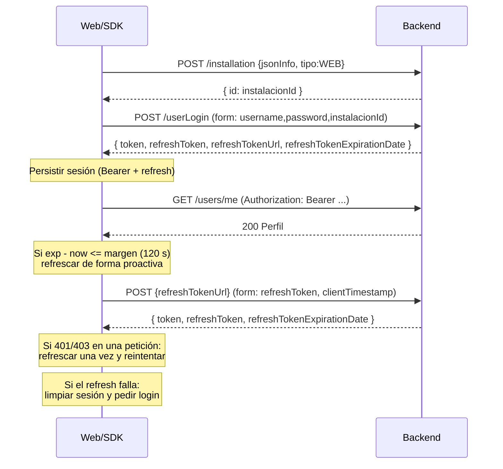

# Tulotero Web API — contrato reconstruido

Especificación y SDK TypeScript de la API que consume la web pública de
**web.tulotero.es**. El contrato se reconstruyó leyendo el bundle JavaScript
público, el mirror local de `IV/` y verificando respuestas reales de endpoints
de solo lectura.

> **Aviso:** no es una especificación oficial de Tulotero. Los nombres de
> campos, rutas y reglas pueden cambiar sin previo aviso. No se accedió a
> credenciales, cuentas ni endpoints privados durante la reconstrucción.

## Contenido

| Archivo | Descripción |
| --- | --- |
| `types.ts` | DTOs TypeScript de peticiones, respuestas y modelos de dominio. |
| `api-client.ts` | SDK modular con auth, refresh, reintentos, errores tipados y geolocalización. |
| `openapi.json` | OpenAPI 3.0.3 con 188 operaciones y 172 rutas, importable en Postman/Insomnia. |
| `build-openapi.mjs` | Generador determinista de `openapi.json`. |
| `redocly.yaml` | Reglas de lint para las particularidades reales del backend. |

## Base URL

```
https://web-backend.es.tulotero.net/tuloteroweb/rest
```

Mirror local usado para pruebas:

```
http://127.0.0.1:4300/backend-proxy-es/tuloteroweb/rest
```

Todas las rutas de `openapi.json` son relativas a esa base, que ya incluye
`/tuloteroweb/rest`.

## Convenciones

- **Fechas:** epoch en milisegundos (`number`), salvo campos explícitamente
  `String` (`fechaNacimientoString`, `creditCardExpiryDate`).
- **Importes:** número decimal en euros.
- **JSON vs formulario:** login, login social, refresh, verificación de teléfono
  y reintegro usan `application/x-www-form-urlencoded`. El resto usa JSON salvo
  los endpoints de subida (`multipart/form-data`).
- **Respuestas de error:** `{ status, message, info, object }`. `status` puede ser
  un código de negocio (`MAIL_EXISTS`, `PROMO_NOT_VALID`, `FRAUD_DETECTED`, …).
- **Paginación:** normalmente `firstResult` + `total`; los históricos de grupos
  usan cursores `idLessThan` / `idGreaterThan`.

## Mapa de recursos por controlador

La tabla completa y siempre sincronizada está en `openapi.json`. Este es el
inventario agrupado por controlador lógico.

### Authentication (10)

`POST /userLogin` · `POST /facebook/login` · `POST /google/login` ·
`POST /apple/login` · `POST /registration` · `GET /beginForgotPassword/` ·
`POST /refreshToken` · `POST /installation` ·
`PUT /device/{registrationId}/locale` · `POST /users/unregister`

### Users (33)

`GET|PUT|DELETE /users/me` · `GET /users/verificarMail` · `PUT /users/mail` ·
`GET|PUT /users/locale` · `POST /users/inicioVerificarNumero` ·
`POST /users/verifyPhoneNumber` ·
`GET /shouldShowPrivacyModalOnRegister/{email}` ·
`PUT /users/extras/add` · `PUT /users/extras/replace` ·
`GET|PUT /users/preferences` · `GET|PUT /users/limits` ·
`POST /users/selfexclusion/generatetoken` ·
`PUT /users/selfexclusion/confirm` ·
`GET /users/autocontroltest/questions` ·
`POST /users/autocontroltest/testResult` ·
`GET /users/autocontroltest/nextAttemptTimestamp` ·
`GET|POST /users/agenda` · `GET /users/sponsor` · `POST /users/sponsor/sms` ·
`GET|POST /users/identity-verification` ·
`GET /users/identity-verification/resend-sms` ·
`GET|POST /users/lastEnvioAddress` · `POST|DELETE /users/photo` ·
`GET /users/administracion`

### Draws (6)

`GET /sorteos/{raffleId}` · `GET /sorteos/{raffleId}/partidos` ·
`GET /sorteos/finished` · `GET /sorteos/finished/{gameTypes}` ·
`GET /matches/sorteos/{raffleId}` · `GET /game/{gameId}/media`

### Play (10)

`POST /users/play` · `POST /users/play/loteria` ·
`POST /users/play/descriptor` · `POST /users/play/descriptor/validate` ·
`POST /users/play/scannercode` · `POST /users/unfinish/play` ·
`POST /users/unfinish/play/descriptor` · `POST /users/unfinish/jugar/loteria` ·
`POST /users/prereserves/play` · `POST /users/prereserves/play/descriptor`

### Lottery (10)

`POST /users/lottery/search` · `POST /lottery/search` ·
`POST /users/lottery/free/search` · `POST /lottery/free/search` ·
`GET /lottery/info/{raffleId}` · `GET /users/lottery/info/{raffleId}` ·
`GET /users/lottery/decimos/{raffleId}` · `GET /lottery/decimos/{raffleId}` ·
`GET /lottery/infoSubscribe` · `POST /users/papeletas`

### Tickets (27)

`GET /users/boletos/me` · `GET /users/boletos/me/{gameIds}` ·
`GET /users/boletos/me/filters` · `GET|DELETE /users/boletos/{ticketId}` ·
`GET /users/boletos/html/{ticketId}` · `PUT /users/boletos/` ·
`PUT /users/boletos/{ticketId}/archive` ·
`PUT /users/boletos/{ticketId}/unarchive` ·
`PUT /users/boletos/{ticketId}/cancel` · `DELETE /users/boletos/archivedAll` ·
`POST /users/compartir` · `POST /users/compartir/prizeReturn` ·
`POST /users/boleto/{ticketId}/subscribe` ·
`GET /users/lottery/boleto/{ticketId}/subscribe` ·
`DELETE /users/abonos/{subscriptionId}/subscription` ·
`POST /users/boleto/repeat` · `GET /users/boleto/{ticketId}/proof` ·
`GET /users/boleto/{ticketId}/notifproof` ·
`POST /users/lotenal/boleto/{ticketId}/constancia` ·
`POST /users/unfinish/boleto/repetir` · `POST /users/enviocasa/v2/` ·
`POST /users/recogida/` · `DELETE /users/recogida/{ticketId}` ·
`GET /users/envioCasa/{ticketId}` · `GET /envioCasa/{ticketId}` ·
`GET /delivery/checkCp`

### Prizes (4)

`GET /users/premios/status/{ticketId}` ·
`POST /users/premios/cancelPickup/{ticketId}` ·
`POST /users/premios/requestDelivery/{ticketId}` ·
`POST /users/premios/signPickup/`

### Wallet (33)

`GET /users/movimientos/me` · `GET /users/movimientos/status/{movementId}` ·
`GET /users/psp/redsys` · `GET /users/movimientos/pspResponse` ·
`POST /users/withdraw` · `GET /users/withdrawInfo` ·
`POST /users/withdraw/v2` · `POST /users/withdrawal/send-otp` ·
`POST /users/withdrawal/verify-otp` ·
`GET /users/credit/bankTransferRedirectInfo` · `POST /users/credit/external` ·
`DELETE /users/creditCard` · `POST|DELETE /users/autoCredit` ·
`DELETE /users/bankaccount` · `POST /users/credit/native` ·
`PUT /users/withdrawalrequest/markAsDisplayed/{requestId}` ·
`GET /users/movimientos/summary` · `GET /users/movimientos/summary/pdf` ·
`POST /users/credit/pci` · `POST /users/credit/pci/savedCard` ·
`POST /users/credit/pci/saveCardWithoutCredit` · `GET /users/paymentmethod` ·
`POST /users/paymentmethod/direct` · `POST /users/paymentmethod/widget` ·
`POST /users/paymentmethod/external/create-widget` ·
`POST /users/paymentmethod/load` · `POST /users/paymentmethod/withdraw` ·
`DELETE /users/paymentmethod/{id}` ·
`POST /users/paymentmethod/favorite/{id}` ·
`GET|POST|DELETE /users/android/subscription`

### Groups (24)

`GET|POST /users/groups` · `GET|PUT /users/groups/{groupId}` ·
`POST /users/groups/join` ·
`PUT /users/groups/{groupId}/members/me/profile` ·
`DELETE /users/groups/{groupId}/members/me` ·
`POST /users/groups/{groupId}/members` ·
`DELETE /users/groups/{groupId}/members/{userId}` ·
`POST /users/groups/{groupId}/balance/{request|withdraw|withdrawParticipants|transfer|transferPending|transferCycle}` ·
`POST /users/groups/{groupId}/balanceBlocked/{withdraw|withdrawAll|transfer}` ·
`POST /users/groups/{groupId}/message` · `POST /users/groups/{groupId}/photo` ·
`GET /users/codes/{code}/availability` · `GET /groups/{code}` ·
`GET /users/groups/{groupId}/history/balance` ·
`GET /users/groups/{groupId}/history` ·
`GET /users/groups/{groupId}/members/{userId}/history`

### Clubs (19)

`GET /penyas/{gameId}` · `GET /users/penyas/{gameId}` ·
`POST /users/penyas/v1/participacion/multiple` ·
`POST /users/penyas/private/join` · `GET /loteriaEmpresas/{code}` ·
`GET /users/penyas/promo/{code}` ·
`GET /loteriaEmpresas/isChildAvailable/{code}` ·
`GET /users/loteriaEmpresas/isChildAvailable/{code}` ·
`POST /users/unfinish/penyas/participacion/multiple` ·
`PUT /users/penyas/hide/{clubId}` · `PUT /users/penyas/mute/{clubId}` ·
`POST|PUT /users/loteriaEmpresas` · `GET|DELETE /users/loteriaEmpresas/{id}` ·
`POST /users/loteriaEmpresas/image` ·
`GET /users/loteriaEmpresas/isPromoCodeFree/{code}` ·
`GET /users/loteriaEmpresas/penyasCreationInfo/{code}` ·
`GET /users/penyas/boletos/{penyaId}`

### KYC (2)

`POST /users/kyc/servlet/{processId}` · `POST /users/kyc/scanner/parse`

### News (5)

`GET /newsflash` · `GET /users/news` · `GET /guestnews/{id}` ·
`GET /users/news/{id}` · `POST /users/news/touch`

### Platform (3)

`GET /endpoint` · `GET /users/allinfo/v2` · `GET /facebook/login/info`

### Support (2)

`POST /users/suggestion` · `POST /suggestion`

## Ciclo de vida de autenticación



### Estrategias

1. **JWT (principal):** `Authorization: Bearer <JWT>`. La expiración se lee del
   propio payload (`exp`, en segundos).
2. **BASIC (legacy):** `Authorization: Basic base64(email:password)`. El
   frontend todavía puede restaurar sesiones antiguas; se mantiene por
   compatibilidad.

### Refresh

- La URL **no es fija**: llega en `refreshTokenUrl` al hacer login y puede
  apuntar a otro host o ruta. Por eso `POST /refreshToken` es solo la forma
  documentada; el SDK usa siempre el valor recibido.
- Cuerpo exacto: `refreshToken` + `clientTimestamp` (epoch ms como texto),
  `application/x-www-form-urlencoded`.
- El frontend hace **single-flight**: varias peticiones concurrentes comparten
  la misma promesa de refresco.
- Si el refresh token caducó (`refreshTokenExpirationDate <= now`) o la
  respuesta no trae `token`/`refreshToken`, se limpia la sesión.

### Almacenamiento observado

| Clave | Contenido |
| --- | --- |
| `0x01` | Access token / token BASIC |
| `0x44` | Estrategia (`JWT` o `BASIC`) |
| `0x45` | Refresh token |
| `0x46` | URL de refresh |
| `0x47` | Caducidad del refresh token |
| `0x05` | Device ID |
| `0x13` | Huella/fingerprint del dispositivo |

En el SDK: `MemoryTokenStorage` (por defecto) y `WebTokenStorage`
(`localStorage`/`sessionStorage`).

## Cabeceras

### Obligatorias en todas las peticiones

| Cabecera | Valor | Origen |
| --- | --- | --- |
| `AvoidRedirect` | `true` | `default-headers.interceptor` |
| `Client` | `web` | `default-headers.interceptor` |
| `Accept-Language` | `es-ES`, `en-GB`, … | locale activo |
| `ngTime` | epoch ms | cache-buster |
| `Accept` | `application/json` | SDK |

### Autenticación

| Cabecera | Valor |
| --- | --- |
| `Authorization` | `Bearer <JWT>` o `Basic <base64(email:password)>` |
| `X-Token-Expired` | `true` — cabecera **interna** del frontend para marcar que el token expiró antes de refrescar; no la envía el backend |

### Dispositivo

Se aplican a `/rest/users/`, `/rest/installation`, `/rest/userLogin` y
`/rest/{facebook|google|apple}/login`.

| Cabecera | Ejemplo | Notas |
| --- | --- | --- |
| `androidRegistrationId` | `fcm-token` | Solo si existe push |
| `deviceId` | `a1b2c3…` | Identificador estable |
| `deviceType` | `WEB` | |
| `deviceDesc` | `Chrome(120.0.0.0)` | Navegador y versión |
| `osVersion` | `Windows(10)` | |
| `versionCode` | `1389` | Versión de la web |
| `mode` | `desktop` / `mobile` | |

### Geolocalización

Se añaden en los flujos de juego, recarga, participación en peñas y
suscripción/repetición de boletos cuando la plataforma lo exige.

| Cabecera | Formato |
| --- | --- |
| `x-geolocation` | `latitud:longitud:precisión` — `40.4168:-3.7038:20` |
| `x-geolocation-timestamp` | epoch ms de la posición |

### Otras

| Cabecera | Uso |
| --- | --- |
| `region` | Noticias y contenido localizado (`ES`, `ALL`, …) |
| `Content-Type` | `application/json`, `application/x-www-form-urlencoded` o `multipart/form-data` |

### Firma de peticiones

**No se encontró firma criptográfica de peticiones** (HMAC, nonce o
`X-Signature`) en el bundle ni en el código reconstruido. La protección real
recae en:

- JWT de corta duración + refresh token,
- cabeceras de dispositivo y geolocalización,
- validaciones de servidor y antifraude.

`ngTime` es un parámetro anticaché, no una firma. Si en el futuro aparece una
firma, debe añadirse en `TuloteroClient.execute` antes de `fetch`.

## Errores y recuperación

| Situación | Detección | Acción del SDK |
| --- | --- | --- |
| Token caducado | `401`/`403` en ruta privada | Refresca una vez y reintenta la petición |
| Refresh fallido | Error en el refresh | Limpia sesión y lanza `SessionExpiredError` |
| Token expirado proactivo | `exp - now <= 120 s` | Refresca antes de enviar |
| Antifraude | `200` con `body.status === "FRAUD_DETECTED"` | Limpia sesión, lanza `FraudDetectedError` |
| Verificación pendiente | `426` | Lanza `VerificationRequiredError` |
| Red/timeout | `fetch` falla o `AbortController` | `NetworkError` / `TimeoutError`, reintento en GET |
| `429`/`5xx` | Estado HTTP | Reintento exponencial con `Retry-After` |
| Error de negocio | `4xx` con `status` | `ApiError` con `code`, `body` y `status` |

Reintentos por defecto: 2 intentos extra, solo `GET`/`HEAD`, estados
`408, 425, 429, 500, 502, 503, 504`. Las operaciones de escritura (juego,
pagos, altas) se marcan con `retry: false` para no duplicar efectos.

## Uso del SDK

```ts
import { createClient, ApiError, FraudDetectedError } from './api-client';

const client = createClient({
  locale: 'es-ES',
  device: {
    deviceId: localStorage.getItem('deviceId') ?? crypto.randomUUID(),
    deviceType: 'WEB',
    deviceDesc: 'Chrome(120.0.0.0)',
    osVersion: 'Windows(10)',
    versionCode: 1389,
    mode: 'desktop',
  },
  geolocation: async () => {
    const pos = await new Promise<GeolocationPosition>((resolve, reject) =>
      navigator.geolocation.getCurrentPosition(resolve, reject, {
        enableHighAccuracy: true,
        timeout: 8000,
      }),
    );
    return {
      coords: {
        latitude: pos.coords.latitude,
        longitude: pos.coords.longitude,
        accuracy: pos.coords.accuracy,
      },
      timestamp: pos.timestamp,
    };
  },
  onFraudDetected: (error: FraudDetectedError) => {
    console.warn('Sesión bloqueada por antifraude', error.message);
  },
});

// 1. Instalación y login
const installation = await client.session.createInstallation({
  jsonInfo: JSON.stringify({ af_status: 'Organic', media_source: '', campaign: '' }),
  tipo: 'WEB',
});

await client.auth.login({
  username: 'user@example.com',
  password: '••••••••',
  installationId: installation.id,
});

// 2. Lecturas públicas y privadas
const draw = await client.draws.getDraw(11357);
const matches = await client.draws.getMatches(11357, 40);
const profile = await client.users.getProfile();
const tickets = await client.tickets.list(0, ['quiniela']);

// 3. Jugar (el SDK añade geolocalización si la ruta la requiere)
await client.play.play({
  almanaque: false,
  abonarse: false,
  aleatorio: true,
  juego: 'quiniela',
  sorteoIds: [draw.id],
  numApuestas: 1,
  totalApuesta: draw.precio ?? 0,
  combinacionJugada: { aleatoria: true, juego: 'quiniela', bets: [] },
});

// 4. Forzar refresco (normalmente es automático)
await client.auth.refresh();

// 5. Errores
try {
  await client.wallet.withdraw({ cuenta: 'ES00…', cantidad: 20, persist: true });
} catch (error) {
  if (error instanceof ApiError && error.code === 'INSUFFICIENT_BALANCE') {
    // tratamiento de negocio
  }
  throw error;
}
```

### Alta de usuario

```ts
const session = await client.session.register(
  {
    name: 'Nombre Apellido',
    mail: 'nuevo@example.com',
    password: '••••••••',
    promoCode: 'PROMO10',
    deviceType: 'WEB',
    registerDeviceId: deviceId,
    instalationId: installation.id, // grafía real del backend
  },
  false,
);
```

`register()` hace el alta y el login automático, igual que el frontend.

### Módulos disponibles

`client.auth` · `client.session` · `client.users` · `client.draws` ·
`client.play` · `client.tickets` · `client.wallet` · `client.groups` ·
`client.clubs` · `client.kyc` · `client.news` · `client.platform` ·
`client.support`

Además, `client.request<T>()` permite llamar a cualquier ruta no cubierta sin
perder auth, cabeceras, reintentos ni normalización de errores.

## OpenAPI

### Importar en Postman

1. **Import → File** y seleccionar `IV/api-spec/openapi.json`.
2. El servidor de producción ya está configurado con
   `https://web-backend.es.tulotero.net/tuloteroweb/rest`.
3. Definir la variable de colección `bearerToken` o usar la autorización
   heredada del esquema `bearerAuth`.
4. Las operaciones públicas (`/endpoint`, `/sorteos/*`, `/newsflash`,
   `/lottery/search`, …) tienen `security: []`.

### Importar en Insomnia

**Create → Import from File** y elegir `openapi.json`. Insomnia crea el
workspace, los entornos y las carpetas por tag.

### Mock

El contrato incluye ejemplos de estructura, pero no ejemplos de respuesta
completos para todas las rutas. Para un mock realista conviene combinar
`openapi.json` con las respuestas capturadas de `GET /sorteos/{id}`,
`/partidos`, `/sorteos/finished`, `/endpoint` y `/lottery/infoSubscribe`.

## Evidencia y confianza

| Área | Evidencia | Confianza |
| --- | --- | --- |
| Login, refresh, BASIC | chunks de auth + `refactor/src/core/auth` | Alta |
| Cabeceras de dispositivo | interceptor de instalación/sesión | Alta |
| Geolocalización | interceptor + servicio de geolocalización | Alta |
| Sorteos, partidos, resultados | respuestas reales de producción | Alta |
| Boletos y mapeo backend | DAO de boletos + modelo | Alta |
| Registro y recuperación | DAO de usuario + formulario | Alta |
| Juego y descriptores | llamadas del bundle + DTOs | Media (payloads complejos) |
| Cartera y pasarelas | DAO de wallet/pagos | Media |
| Grupos y clubes | DAO de grupos/peñas | Media |
| KYC | llamadas del bundle | Media/baja |
| Noticias | llamadas del bundle | Media |

Rutas incluidas por evidencia directa en el bundle pero sin verificación en
vivo: la mayoría de `POST` privados, `KYC`, y algunas variantes legacy. Están
marcadas por su descripción y deben validarse contra el backend antes de
usarlas en producción.

## Regenerar y validar

```bash
# Regenerar el contrato
node IV/api-spec/build-openapi.mjs

# Validar OpenAPI (0 errores)
npx -y @redocly/cli@latest lint IV/api-spec/openapi.json \
  --config IV/api-spec/redocly.yaml

# Typecheck del SDK y los DTOs
npx -y -p typescript tsc --noEmit --strict --target ES2020 \
  --lib ES2020,DOM --module esnext --moduleResolution bundler \
  IV/api-spec/api-client.ts
```

Resultado actual: **OpenAPI válido**, **188 operaciones / 172 rutas**,
**TypeScript estricto sin errores**.
